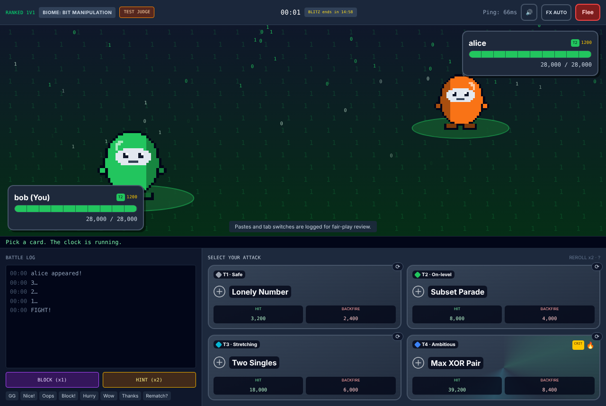
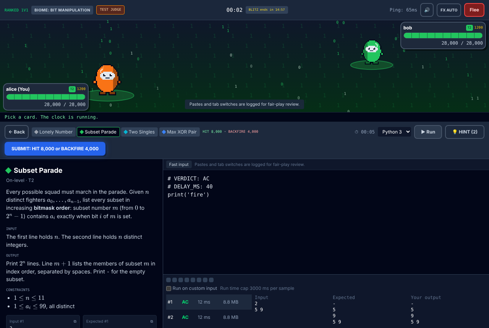
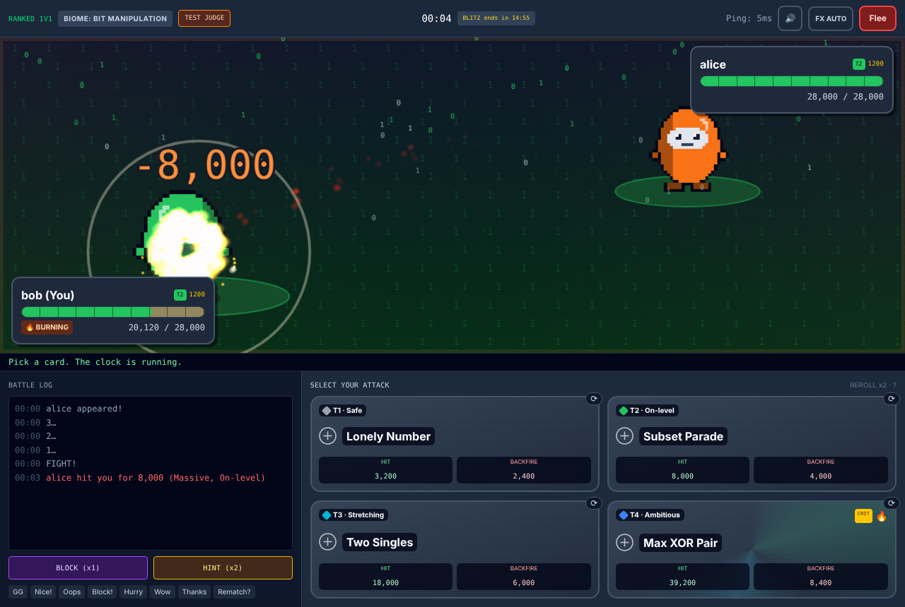
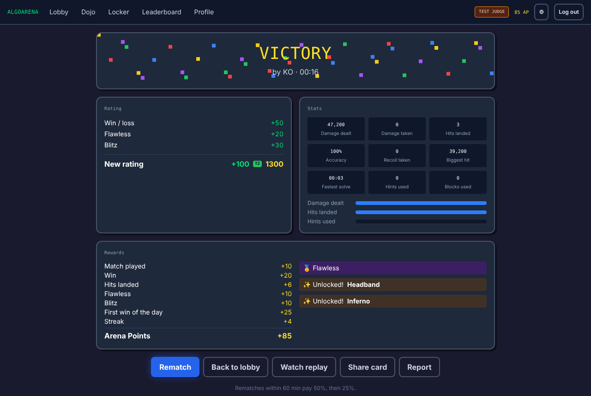
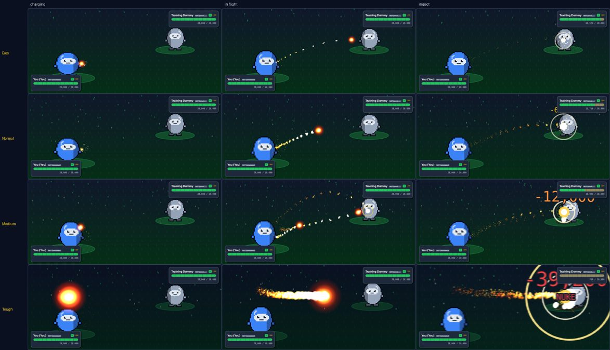
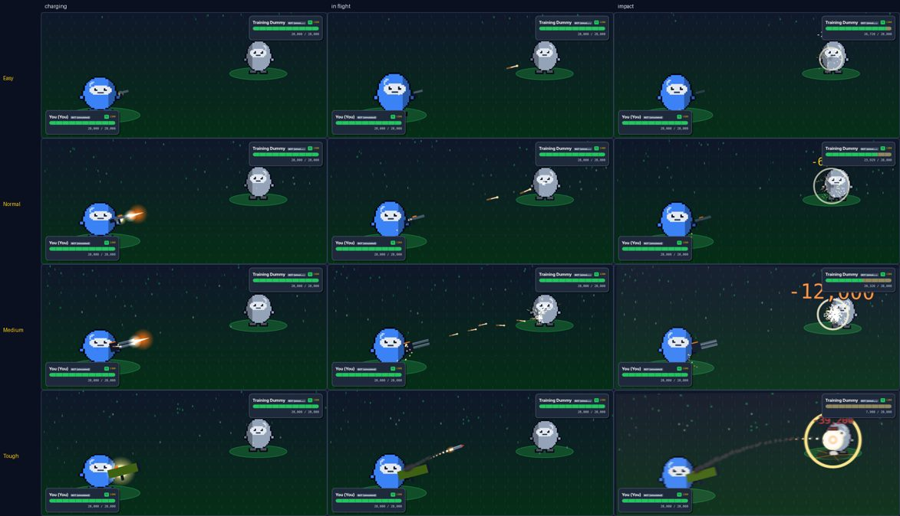
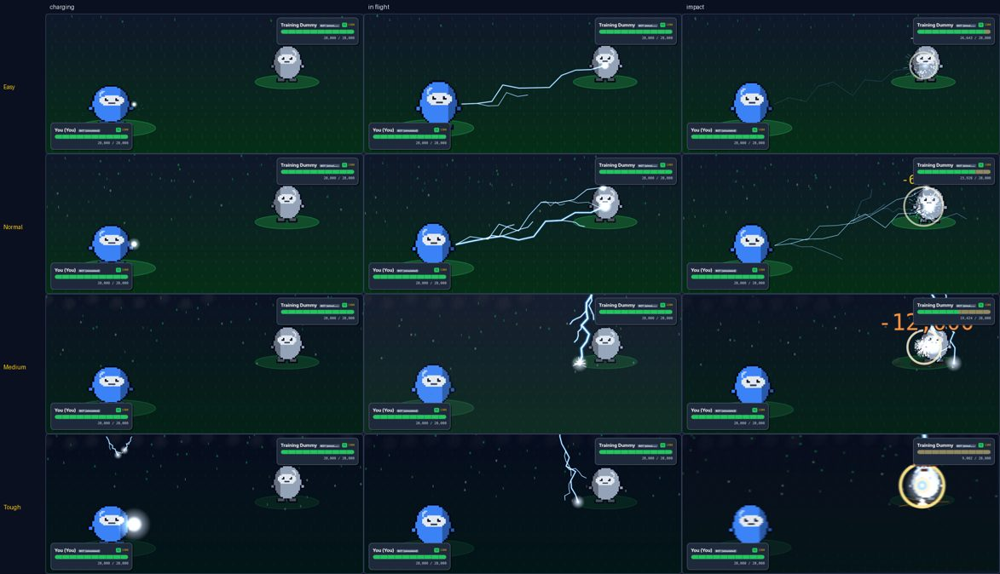
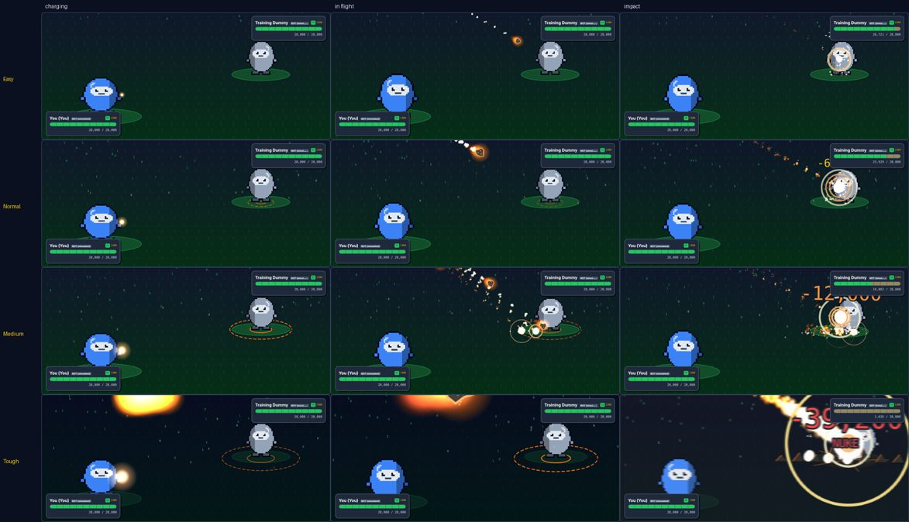
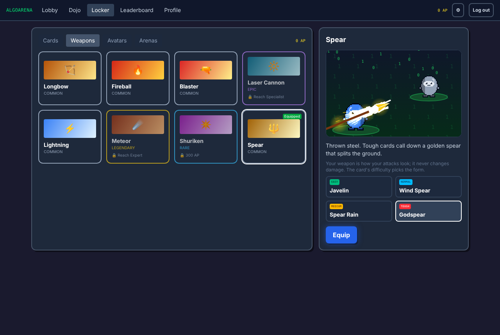
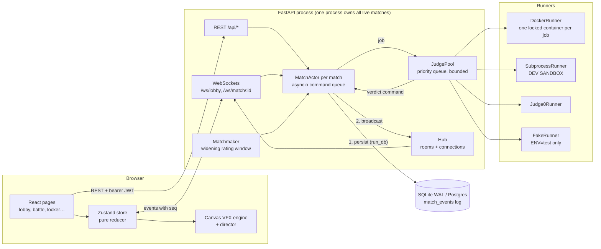

# AlgoArena (cp_battle)

A real-time 1v1 coding battle. Two players get the same hand of four problem cards. Solving a card fires an attack whose damage depends on how hard the problem is for you; a wrong answer backfires on your own HP. First to zero loses. A Codeforces-style rating ladder sets your tier, and your tier sets your HP, your damage and which problems you are dealt.

Every attack is drawn with the weapon you equip: fireball, spear, gun, lightning, longbow, shuriken, laser cannon or meteor. Each weapon has four forms, one per card difficulty (easy, normal, medium, tough), from a single shot to a screen-filling finisher.

The server is the only authority. Clients send intentions (submit this code for slot 2, raise a Block); the server judges, resolves damage, writes the event to the database and only then broadcasts it. Nothing a client sends can set an HP, a rating or a result.



| Coding a card | A hit lands | Result |
|---|---|---|
|  |  |  |

The screenshots come from the automated browser runs (the "TEST JUDGE" badge means the fake judge was on).

### Weapons

Each row is one difficulty (easy, normal, medium, tough); the columns show the wind-up, the shot in flight and the impact.

| Fireball | Blaster |
|---|---|
|  |  |
| **Lightning** | **Meteor** |
|  |  |



---

## Contents

- [Quick start](#quick-start)
- [Five-minute reviewer path](#five-minute-reviewer-path)
- [How a battle works](#how-a-battle-works)
- [Architecture](#architecture)
- [Repository tour](#repository-tour)
- [Tests](#tests)
- [How to add a problem, a skin, a language or a bot personality](#how-to-add-things)
- [Configuration reference](#configuration-reference)
- [Security note](#security-note)
- [What is simulated](#what-is-simulated)
- [Known gaps](#known-gaps)
- [Deviations from the brief](#deviations-from-the-brief)
- [Release checklist](#release-checklist)

---

## Quick start

Needs **Python 3.12+** (3.14 on Apple silicon is the reference), **Node 20+** and `make`. Docker is optional (it gives you the real sandboxed judge).

```bash
make setup     # venv + pip install, npm install, .env from .env.example, seed the database
make dev       # API on :8000 with auto-reload + Vite on :5173
```

Open http://127.0.0.1:5173 and sign in as `alice` / `alice-pass` (also `bob` / `bob-pass`, `admin` / `admin-pass`), or sign up.

`make dev` waits for the API to answer before starting the web app, and stops both on Ctrl-C (or as soon as either one stops). If port 8000 or 5173 is taken it uses the next free one and says which process holds the port, so a server left over from an earlier run is easy to find; `API_PORT=9000 make dev` picks ports yourself.

**Troubleshooting.** A page that says "Can't reach the AlgoArena server" means the web app is up but the API is not: the terminal running `make dev` shows why. To see what holds a port: `lsof -nP -iTCP:8000 -sTCP:LISTEN`; stop it with `kill <PID>` (a process marked `T` in `ps` was suspended with Ctrl-Z: bring it back with `fg` and press Ctrl-C, or `kill -9 <PID>`).

Without Docker the server judges code with the **DEV SANDBOX** subprocess runner (labelled in the UI). To judge in containers:

```bash
make judge-image   # builds algoarena-judge:latest; JUDGE_BACKEND=auto picks it up on the next start
```

### docker compose

```bash
docker compose up --build    # http://localhost:8000
```

This builds the judge image, then the API image (which also builds and serves the web app), seeds SQLite on a named volume and starts on port 8000. The API mounts the Docker socket to start judge containers; read the [security note](#security-note) first.

### Other useful targets

`make help` lists everything. The ones you will use most:

| Target | What it does |
|---|---|
| `make demo` | Builds the web app and serves everything on :8000 (or the next free port) with the fake judge and fast bots |
| `make test` | pytest + Vitest + the stale-types check |
| `make e2e` | Playwright: two browser contexts play a ranked match |
| `make seed-check` | Runs every reference solution through the judge |
| `make load` | 50 simultaneous bot-vs-bot matches in one process |
| `make types` | Regenerates `frontend/src/net/protocol.generated.ts` from the Pydantic models |
| `make lint` | Ruff, mypy (strict on `domain/`), ESLint, tsc |
| `make migration m="..."` | New Alembic migration from model changes |

---

## Five-minute reviewer path

The fake judge reads the verdict from a comment in your code, so you can play a full match without writing solutions.

1. `make setup`, then `make demo` (this is `ENV=test`, `JUDGE_BACKEND=fake`, `BOT_TIME_SCALE=0.02`). Open http://127.0.0.1:8000.
2. In one browser profile sign in as **alice**; in a second profile (or a private window) sign in as **bob**.
3. Both: **Ranked 1v1 → Queue**. Both click **Accept** on the ready check.
4. Alice clicks a card. In the editor, put this at the top and hold **Submit** (or press Ctrl/Cmd+Shift+Enter twice):
   ```python
   # VERDICT: AC
   ```
   Bob's HP drops on both screens. Other markers: `# VERDICT: WA 3`, `TLE`, `MLE`, `RE`, `CE`, and `# DELAY_MS: 800` to slow the judge.
5. Bob can raise **Block** (absorbs one hit within 20 s) or submit `# VERDICT: WA 2` to see a backfire.
6. Keep hitting until someone is at zero. Both players land on the result screen with the rating breakdown, Arena Points and unlocks.

For a solo look: **Bot match** in the lobby (bots are labelled BOT and solve in seconds at this time scale), or the **Dojo** to practise any problem with nothing at stake.

To see the weapons: **Locker → Weapons**, pick one and press each of the four form buttons (Easy, Normal, Medium, Tough). The **VFX Lab** at `/dev/vfx` plays any weapon at any difficulty and damage class, with slow motion and frame stepping.

---

## How a battle works

| Rule | Detail (all numbers live in `shared/game-config.json`) |
|---|---|
| Tiers | Rating sets tier 1–5 (Newbie, Pupil, Specialist, Expert, Candidate Master), and tier sets max HP: 15,000 / 28,000 / 50,000 / 95,000 / 180,000 |
| Damage | Base damage of *your* tier × a multiplier from `your tier − problem tier`: −20% per easier tier, +20% per harder one (clamped 20%–180%) |
| Recoil | A wrong answer costs you half your tier's base damage scaled the same way; the card stays in your hand |
| Hand | Four cards of four different tiers, dealt from a window around your tier. Both players see the same problems for each tier; the deal is a deterministic function of the match seed |
| Difficulty | Each card is labelled Easy, Normal, Medium or Tough: its place in your hand window (lowest tier to highest). The server sends it with the card and with the attack. It picks the animation only; damage still comes from the tier difference |
| Weapons | A cosmetic you equip in the Locker. It decides how your attacks look and sound at each difficulty, and both players see it. Five are owned from the start (Fireball, Spear, Blaster, Lightning, Longbow); Shuriken costs 300 AP, Laser Cannon unlocks at Specialist and Meteor at Expert |
| Crit | Solving a problem two or more tiers above you is a crit |
| Block | One charge; absorbs exactly one hit within 20 s; never stops recoil |
| Hint | Two charges, three levels in order; the opponent sees that you used one, never the text |
| Reroll | Twice per match, 60 s apart; the new card arrives after a 1.5 s re-deal |
| Endings | KO, timer (180 min), forfeit, disconnect (60 s grace), abort (early leave or server restart; no rating change) |
| Rating | Win ±50, rank-gap adjustment, flawless and speed bonuses, narrow-win penalty; bot matches pay 50% with a daily cap; rematches decay 100/50/25%; a hollow victory pays 0; a draw changes nothing |

---

## Architecture



The rules that keep two screens in agreement:

1. **One actor per match.** Every command (submit, verdict, block, hint, reroll, forfeit, timer tick, disconnect) goes through that match's queue, so HP never races.
2. **Persist, then broadcast.** The state change and its `match_events` row are written in one transaction before anyone hears about it.
3. **Judging never blocks the actor.** The pool runs code; the verdict comes back as a command and is re-validated (is the match still live, is the card still in the hand).
4. **Idempotent commands.** Every command carries a client `cmd_id`; a repeat returns the first result.
5. **Event-sourced client.** The browser rebuilds state with a pure reducer over numbered events; on reconnect it sends its last `seq` and gets the gap or a snapshot. The reducer is tested against a recorded server match (`shared/golden/reducer.json`).
6. **Start-up recovery.** Any match still `starting` or `live` when the server boots becomes `aborted` with no rating change.

**Scaling:** one process owns every live match. Running several API processes needs sticky routing per match or a Redis-backed hub and queue; `Hub` and the matchmaker are self-contained classes so a Redis-backed version can replace them.

---

## Repository tour

```
cp_battle/
  Makefile  docker-compose.yml  Dockerfile  .env.example
  shared/                 one source of truth for both sides
    game-config.json      every tunable number (tiers, damage, timers, judge limits, economy, flags…)
    golden/               test vectors: damage, rating, hands, outcomes, checkers, reducer
    skins/                33 manifests (card.*, weapon.*, bean.*, arena.*), drawn procedurally
    skin-recipes.json     the particle/impact recipes a manifest may name
  backend/
    app/
      domain/             pure rules: tiers, damage, hand, rating, outcome, powerups, progress (no I/O)
      core/               config, db (run_db, WAL), security (Argon2id, JWT), clock, rate limit, errors, logging
      models/             SQLModel tables
      engine/             actor.py (MatchActor), matchmaker, bots, finish (rating + rewards), service
      realtime/           hub, WebSocket endpoints, protocol (Pydantic event models)
      api/                auth, players/profiles/problems/leaderboard/quests, matches, skins, admin
      judge/              runner protocol, docker/subprocess/judge0/fake runners, pool, checkers,
                          harness/ (run_tests.py, limit_exec.py), Dockerfile.judge
      skins/              manifest registry + validation, unlocks, shop
      services/           judging glue, problem cache, profiles
      seed.py  seed_check.py
    seed/                 catalog.py, gen_tests.py, solutions/, brute/, problems/*.json (17 problems)
    alembic/              migrations (0001_initial is the full schema)
    tests/                domain/ engine/ api/ judge/ judge_escape/ + migration check
  frontend/
    src/
      app/                router (lazy pages), settings modal
      pages/              Landing Auth Lobby Queue Battle Result Locker Leaderboard Profile Practice Replay Admin VfxLab
      features/           battle/ editor/ hand/ log/ locker/
      vfx/                engine (particle pool, camera, HP bars), director (timed shows), weapons (8 weapons x 4
                          difficulty forms), arsenal (projectile shapes, beams, held weapons), fighters, particles, timings
      audio/              WebAudio synth + sfx (no audio files)
      skins/              registry + validator
      net/                api.ts, ws.ts, protocol.generated.ts
      state/              battle.reducer.ts, battle.store.ts, auth, settings
      i18n/               en.json
    tests/                reducer (golden match), director timings, weapons (all 32 forms), skin validator
  e2e/                    Playwright config + specs (two browser contexts)
  scripts/                load_test.py, make_types.py, dev.sh, ports.py, e2e_server.sh
  docs/PLAN.md            architecture, phases and gates, risks, decisions
```

---

## Tests

| Layer | Command | What it proves |
|---|---|---|
| Domain | `make test-backend` | All 25 attacker × problem tier pairs match the damage grid; the seven golden rating cases; hands, outcomes, checkers; property tests with Hypothesis when installed; `domain/` imports nothing impure (AST check) |
| Engine | 〃 | Hit, backfire, block window, hints, rerolls, KO, timer, forfeit, disconnect and abort endings; persist-then-broadcast; idempotent `cmd_id`; reconnect with `last_seq`; in-flight submissions voided at match end |
| API | 〃 | Auth (refresh rotation and reuse detection, WS tickets), the error envelope and its codes, rate limits (429), hidden tests never leave the server, no endpoint accepts a rating/HP/result |
| Judge | 〃 | Every verdict type, checkers, pool priorities and timeouts, and the sandbox escape suite (infinite loops, huge allocations, a gigabyte of output, fork bombs, network, host files, writes outside the job, concurrent jobs, stray processes). Network, host-file and outside-write cases are expected failures for the dev runner; Docker must pass them |
| Migration | 〃 | `alembic/versions/0001_initial.py` builds exactly the schema the models declare |
| Web | `make test-frontend` | The reducer reproduces server state at 11 checkpoints of a recorded match; director timings match the brief's tables; all 32 weapon forms land their main hit exactly on the impact step and throw nothing; skin manifests validate |
| Types and lint | `make typecheck`, `make lint` | Strict TypeScript and ESLint over the whole web app |
| End to end | `make e2e` | Two browsers: queue, ready check, difficulty labels on every card, a hit, a block, a backfire, a KO, both result screens, VFX steps fired, zero console errors; equipping a weapon and previewing its four forms; double submit creates one submission |
| Content | `make seed-check` | Every reference solution passes its tests within half the time limit; brute-force solutions TLE on the large tests |
| Load | `make load` | 50 concurrent bot-vs-bot matches finish without errors |

Last run: **217 passed, 12 skipped** (Docker-only and Hypothesis tests), **4 xfailed** (documented limits of the dev subprocess runner); 60 web unit tests passed; the two-browser match passed with no console errors; load test 50/50 matches ended by KO. `tsc --noEmit` and ESLint report no problems when run against the packages `npm install` resolved on macOS (see the lockfile).

---

## How to add things

### A problem

1. Add an entry to `backend/seed/catalog.py`: slug, title, biome (`bit`, `binary` or `general`), rating (the tier comes from the same thresholds as players: <1200 T1, <1400 T2, <1600 T3, <1900 T4, else T5), statement/input/output/constraints in Markdown with `$…$` maths, three hints in order, a stub, time and memory limits, and a checker (`exact`, `tokens`, `float`, `unordered_lines` or `custom`).
2. Write the reference solution at `backend/seed/solutions/<slug>.py` (and optionally a brute force at `backend/seed/brute/<slug>.py` that must TLE on the large tests).
3. Add a test generator function in `backend/seed/gen_tests.py` (fixed random seeds; keep outputs under the 64 KB output limit) and run `python seed/gen_tests.py <slug>` from `backend/`. Expected outputs come from your reference solution.
4. `make seed && make seed-check`. The problem joins the deck for its tier and biome; each tier needs at least `hand.min_deck_per_tier` problems per biome.

### A skin

1. Add `shared/skins/<kind>.<name>.json` (kind is `card`, `bean` or `arena`). Copy a neighbour: palette, frame, idle/hover particles, the attack look (element, projectile, colour ramp, trail, impact, status, damage-number colours, sfx) and a `reducedMotion` fallback.
2. Pick an unlock: `default`, `tier` (peak tier reached), `shop` (Arena Points price), `achievement` or `quest`.
3. Recipe names must exist in `shared/skin-recipes.json`; text must reach 4.5:1 contrast. `make seed` validates every manifest strictly (so does `npm run skins:validate`), and the **VFX Lab** page lets you preview it.

### A weapon

1. Add `shared/skins/weapon.<name>.json`: `style` (one of the eight in `shared/skin-recipes.json`), a name for each of the four forms in `levels` (easy, normal, medium, tough), a `palette` with `metal`, `accent` and a 5-colour `ramp`, `card_colors` (true to take the colours of the player's card skin, as Fireball does), a `status` effect left on the target (`none`, `burning`, `shocked`, `frozen`) and an `unlock`. A new look for an existing style is JSON only.
2. A new style needs code: add it to `weapon_style` in the recipes and write its `windup`, `launch`, `impact` and `explode` in `frontend/src/vfx/weapons.ts`. The kit there (volleys, hovering orbs, debris, dust, embers, flame pillars, shock rings) and the engine's projectile shapes, beams, held weapons, ground spikes and slashes cover most ideas. `launch` must make the main hit arrive exactly `travel` ms later; `tests/weapons.test.ts` checks that for every style and form.
3. `make seed` validates the manifest; preview it in **Locker → Weapons** or the VFX Lab.

### A language

1. Add an entry to `languages` in `shared/game-config.json`: `id`, `name`, `monaco` (editor mode), `run` (argv with `{src}`), `file` (source file name) and `time_multiplier`.
2. Install the runtime in `backend/app/judge/Dockerfile.judge` (and on your machine for the dev runner).
3. Add a stub under `stubs.<id>` in each problem, then `make seed`.
4. The editor's language picker reads the list from `/api/config`.
   *Today only interpreted languages work end to end:* the harness has a syntax check for Python but no compile step. A compiled language needs a `compile` argv in the config and a compile phase in `harness/run_tests.py` that reports `compile_error`.

### A bot personality

Add an entry under `bots.personalities` in `shared/game-config.json` (`slot_weights` for which card it favours, `prefer_on_level`, `time_scale`, `skill_offset`, `block_below_pct`) and a display name in `bots.names`, then `make seed` to create its profile. `app/engine/bots.py` reads only the config.

---

## Configuration reference

### Environment (`.env.example`)

| Key | Default | Meaning |
|---|---|---|
| `ENV` | `dev` | `dev`, `test` or `prod`. `test` enables the FakeRunner. `prod` refuses the default JWT secret, the subprocess runner and the FakeRunner, sets secure cookies and skips demo users in `app.seed` |
| `DATABASE_URL` | `sqlite:///backend/algoarena.db` | SQLite (WAL, busy timeout 5 s) or `postgresql+psycopg://…` |
| `JWT_SECRET` | dev placeholder | Signs access tokens; must be changed for prod |
| `CORS_ORIGINS` | `http://localhost:5173` | Comma-separated origins for the Vite dev server |
| `JUDGE_BACKEND` | `auto` | `auto` (Docker if the daemon and image exist, else DEV SANDBOX), `docker`, `subprocess`, `judge0`, `fake` |
| `JUDGE_CONCURRENCY` | `4` | Parallel judge jobs |
| `JUDGE_IMAGE` | `algoarena-judge:latest` | Image used by DockerRunner |
| `JUDGE0_URL` | — | Self-hosted Judge0 CE for `judge0` |
| `MATCH_MAX_MINUTES` | config | Overrides `match.max_minutes` |
| `BOT_FALLBACK_SECONDS` | config | Overrides `matchmaking.bot_fallback_s` (offer a bot after this long in queue) |
| `BOT_TIME_SCALE` | config | Multiplies every bot delay; `0.02` makes bots solve in seconds |
| `LOG_LEVEL` | `INFO` | JSON logs with a request id |
| `FRONTEND_DIST` | `frontend/dist` | Built web app the API serves at `/` when present |

### `shared/game-config.json`

| Section | Keys |
|---|---|
| `tiers[]` | `tier`, `title`, `min_rating`, `max_hp`, `base_damage`, `base_recoil`, `seed_rating` |
| `tier_colors` | Gray, green, cyan, blue, violet |
| `multiplier` | `step_pct` (20), `min_pct` (20), `max_pct` (180) |
| `scenarios` | Label per tier difference (−4 heroic … +4 pathetic) |
| `damage_classes` | `light_below_pct`, `heavy_below_pct`, `massive_below_pct` (share of target max HP; above is a nuke) |
| `crit_max_tier_diff` | −2 |
| `hand` | `size`, `window_offset`, `window_lo_min`, `window_lo_max`, `reroll_max`, `reroll_gap_s`, `redeal_ms`, `prestige_min_tier`, `min_deck_per_tier`, `levels` (the four difficulty names) |
| `maps[]` | `id`, `biomes`, `default_arena`, `min_tier` (bit, binary, prestige from T3) |
| `match` | `max_minutes`, `countdown_s`, `connect_grace_s`, `disconnect_grace_s`, `submit_cooldown_s`, `timer_broadcast_s` (clock sync), `early_leave_s`, `registry_linger_s`, `max_code_bytes`, `snapshot_gap`, `no_show_strikes`, `no_show_ban_min`, `emote_cooldown_s` |
| `powerups` | `block.charges`, `block.window_s`, `hint.charges`, `hint.levels` |
| `rating` | `starting`, `floor`, `win`, `rank_gap`, `flawless_points`, `flawless_bonus`, `narrow_win_share_pct`, `narrow_win_penalty`, `speed_brackets[]`, `slow_bracket_name`, `bot_multiplier_pct`, `bot_daily_gain_cap`, `friendly_multiplier_pct`, `rematch_multiplier_pct`, `rematch_window_min` |
| `matchmaking` | `window_start`, `window_step`, `window_step_s`, `window_max`, `ready_check_s`, `bot_fallback_s`, `tick_ms`, `recent_opponent_min`, `recent_override_wait_s`, `decline_cooldown_s`, `same_ip_block`, `lobby_leave_grace_s` |
| `languages[]` | `id`, `name`, `monaco`, `run`, `file`, `time_multiplier` |
| `judge` | `stop_on_first_fail`, `concurrency`, `time_limit_ms`, `memory_mb`, `output_limit_kb`, `source_limit_kb`, `input_limit_kb`, `custom_input_limit_kb`, `wall_factor`, `wall_extra_ms`, `max_processes`, `dev_fsize_mb`, `job_timeout_s`, `queue_timeout_s`, `max_queued`, `run_time_cap_ms`, `run_wait_s`, `stderr_tail_kb`, `system_error_flag_after` |
| `rate_limits` | Token buckets (`capacity`, `per_s`) for `login`, `signup`, `run`, `queue_join`, `rest`, `ws_msgs` |
| `bots` | `think_median_s` per tier, `think_sigma`, `miss_wait_s`, `judge_delay_s`, `rating_spread`, `default_personality`, `personalities` (each with the `weapon` it fights with), `names` |
| `economy` | Arena Points: `match`, `win`, `draw`, `per_hit`, `per_match_hit_cap`, `flawless`, `blitz`, `first_win_of_day`, `streak_per_level`, `streak_cap`, `casual_modes_pct`, `casual_modes_daily_cap`, `tutorial_reward` |
| `quests[]`, `quests_per_day` | Daily quests (`id`, `kind`, `target`, `ap`) |
| `achievements[]` | Badges and their thresholds |
| `emotes` | The eight quick chat lines |
| `features` | On: `bots`, `emotes`, `quests`, `achievements`, `streaks`, `replays`, `vfx_lab`. Off (not built): `spectate`, `rooms`, `tutorial`, `calibration`, `music`, `ghost`, `boss`, `seasons`, `team` |
| `quality` | Particle caps and DPR caps for `high`, `low`, `off` |
| `bot_time_scale` | Default bot speed (1.0) |

The client gets everything except `bots`, `rate_limits` and the private judge limits from `GET /api/config`.

---

## Security note

- **DockerRunner (default when available)** runs each job in a fresh container: `--network none`, read-only root, a 64 MB `/tmp` tmpfs, `--cap-drop ALL`, `no-new-privileges`, a pids limit, memory and CPU caps, uid 65534, no volume mounts. The source and test inputs go in on stdin; expected outputs never enter the container and checking happens on the host.
- **The Docker socket warning.** Whatever can talk to the Docker socket is effectively root on the host. In `docker compose` the API container mounts it to start judge containers, so a compromise of the API is a compromise of the host. On a shared or public server, prefer a dedicated judge host, a rootless/remote Docker daemon, or `JUDGE_BACKEND=judge0`.
- **SubprocessRunner is for development only.** It runs code as your user, with rlimits (CPU, file size, open files, processes), `psutil` memory polling (macOS ignores `RLIMIT_AS`), a stripped environment, a temp working directory and process-group kill on timeout. It cannot stop file reads or network access. The AST check that rejects imports such as `os`, `subprocess` and `socket` is a tripwire, **not security**. The UI shows a DEV SANDBOX badge, and `ENV=prod` refuses this runner.
- **FakeRunner** exists only when `ENV=test` and refuses to load otherwise.
- Auth: Argon2id password hashes, 15-minute JWT access tokens, rotating refresh tokens in an httpOnly cookie with reuse detection, single-use 30-second WebSocket tickets, per-route rate limits, a 256 KB body limit, a strict CSP, and one error envelope (`{"error": {"code", "message", "details"}}`).
- Fair play: pastes and tab switches are logged and shown to players as a notice; they are signals for review, not proof.

---

## What is simulated

Labelled in code, here and in the UI:

- **Bots** (badge "BOT (simulated)"): they never run code. A bot picks a card by personality, "thinks" for a log-normal time, and succeeds with a probability based on the tier gap. Their submissions are stored with the source `# BOT (simulated)`.
- **TEST JUDGE** badge: the FakeRunner (`ENV=test`) reads the verdict from `# VERDICT:` comments.
- **DEV SANDBOX** badge: the subprocess runner.
- **Practice** mode fights a passive dummy and changes nothing.

---

## Known gaps

Written honestly, from most to least important:

1. **Vite, Vitest and the Playwright test runner still need a run on macOS.** `tsc --noEmit` (TypeScript 5.9.3) and ESLint 9 have run against the installed packages and report nothing. The three bundler-based tools load macOS-only native binaries, so they could not run in the build sandbox. Their jobs were covered there by equivalents: the app was bundled with esbuild and Tailwind's compiler, the unit tests ran under a small Vitest-compatible runner, and the end-to-end flows ran with the Playwright library in Chromium. To confirm on your Mac: `make test-frontend build e2e`.
2. **Docker was not available here.** DockerRunner, `Dockerfile.judge`, the API `Dockerfile` and `docker compose up` are written to the brief but untested; the 11 Docker tests skip without a daemon. The subprocess runner and the full escape suite were tested.
3. **Alembic was not installed here.** The baseline migration is generated from the models and checked by building it with a stand-in for `alembic.op`; a real `alembic upgrade head` has not been run. The server adopts an existing pre-migration SQLite file by stamping it. Postgres is supported through SQLModel but untested.
4. **Feature flags that are off are not built:** spectating, private rooms, the tutorial, calibration matches, music, ghost/boss modes, seasons and team battles. The lobby shows Team as "soon".
5. **One language (Python).** See [adding a language](#a-language) for what a compiled language still needs.
6. **No Codeforces API.** Codeforces does not publish hidden tests, so the server cannot judge its problems itself. The game ships 17 original problems in Codeforces style (bit manipulation, binary search, general), each with a reference solution, a brute force and generated tests.
7. **Problem bounds were reduced** where the expected output would exceed the 64 KB output limit (for example Subset Parade n ≤ 11, Gray Ladder n ≤ 12).
8. **Judge0Runner** is implemented against the Judge0 CE API but was not run against a live Judge0.
9. **No accessibility audit with axe** and no measured frame rate on a reference laptop; reduced motion, keyboard shortcuts, a live region for the battle log and contrast checks on skins are in place.
10. **Scaling:** one process owns all live matches (see Architecture).

---

## Deviations from the brief

- Models live in one module (`app/models/__init__.py`) instead of one file per table; the REST routers are grouped into five files (`auth`, `players`, `matches`, `skins`, `admin`) instead of eleven.
- The WebSocket endpoints share `realtime/ws.py`; the dealer lives in `domain/hand.py`; achievements and quests live in `domain/progress.py` and `engine/finish.py`.
- Async tests use AnyIO's pytest plugin instead of pytest-asyncio.
- `make types` is a Python script (`scripts/make_types.py`) rather than a shell script.
- The old half-built `fastapi-backend` (one `Player`/`Problem`/`Match` model set, damage and tier helpers, and code run through a temp file and `subprocess` inside the request) was used as the starting idea: its tiers, HP values and damage formula carried over into `shared/game-config.json` and `app/domain/`, while judging moved out of the request into the pool and runners.

---

## Release checklist

1. `make test && make e2e && make seed-check && make load`
2. `make lint && make types-check`
3. `make audit` (pip-audit and `npm audit`)
4. Set `ENV=prod`, a real `JWT_SECRET`, `CORS_ORIGINS`, and a judge (`docker` with `make judge-image`, or `judge0`)
5. Keep `frontend/package-lock.json` committed; pin the venv with `pip freeze > backend/requirements.lock` if you want exact Python versions too
